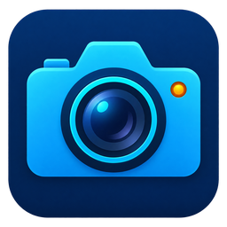

# KohdaLab Camera

[](https://github.com/woolen-yarn/kohdalab-camera/actions/workflows/windows-unsigned.yml)
[](https://github.com/woolen-yarn/kohdalab-camera/releases/latest)
[](LICENSE)

Rust desktop application for laboratory camera acquisition, live imaging, and reproducible image export.

実験室用カメラの取得、ライブ表示、再現可能な画像出力を行う Rust デスクトップアプリケーションです。

[Download / ダウンロード](https://github.com/woolen-yarn/kohdalab-camera/releases) · [Documentation / ドキュメント](docs/README.md) · [Report an issue / Issue を報告](https://github.com/woolen-yarn/kohdalab-camera/issues)

- Live preview with exposure/gain controls and image adjustments.

  露光・ゲインと画像補正を伴うライブプレビュー。
- Processed PNG/TIFF, original Bayer TIFF/RAW, and metadata exports.

  処理済み PNG/TIFF、元の Bayer TIFF/RAW、およびメタデータの出力。
- An isolated acquisition helper owns the physical session; simulation is available without hardware.

  物理セッションは分離された取得ヘルパーが所有し、ハードウェアなしの Simulation も利用可能です。

## Interface / 画面


Native interface in Simulation on macOS. Published executables currently target Windows x64; window decorations differ.

macOS の Simulation で撮影したネイティブ画面です。公開済み実行ファイルは現在 Windows x64 向けであり、ウィンドウ装飾は異なります。

## Downloads / ダウンロード

| Channel / チャンネル | Version / バージョン | Platforms / プラットフォーム |
| --- | --- | --- |
| Stable / 安定版 | [0.1.15](https://github.com/woolen-yarn/kohdalab-camera/releases/tag/v0.1.15) | Windows x64 Setup / portable ZIP |

Rust and Python are not required to run the packaged application. Current Windows artifacts are unsigned; download packages and checksums together from Releases.

### Optional GUI control API

Camera exposes an opt-in, loopback-only observer when started with `--gui-api`. It publishes a canonical descriptor under `~/.kohdalab/camera/run` and serves `control.describe`, `control.status`, and `control.config` from the GUI thread's `Worker` snapshot. The adapter does not auto-connect to a camera, expose internal IPC, acquire ownership, or perform capture/stop mutations; those operations remain GUI-only until a separate safety review. `describe.safety.supports_ownership` is therefore `false`.

パッケージ版の実行に Rust や Python は不要です。現行の Windows 成果物は未署名なので、Releases からパッケージとチェックサムを一緒に取得してください。

### オプションのGUI制御API

`--gui-api`を付けたときだけ、GUIスレッドの`Worker`スナップショットを読むloopback専用APIを起動します。`control.describe`・`control.status`・`control.config`のみを提供し、物理カメラへの自動接続、内部IPC公開、所有権取得、撮影・停止操作は行いません。`describe.safety.supports_ownership`は`false`です。

## Supported hardware / 対応機器

| Source / 機器 | Support / 対応範囲 |
| --- | --- |
| SHODENSHA GR300 | Tested laboratory unit: Micron MT9T001, USB `0547:4d33`, existing WinUSB binding / 検証済み実験室ユニット: Micron MT9T001、USB `0547:4d33`、既存 WinUSB binding |
| Simulation / demo | Synthetic source; no camera required / 合成ソース。カメラ不要 |
| Other camera models / その他のカメラ | Not supported yet / 現在は未対応 |

See [camera support and qualification](docs/reference/hardware.md). A matching model name or USB ID alone does not establish compatibility. Multi-camera/vendor support is a roadmap, not a current capability.

詳細は [camera support and qualification](docs/reference/hardware.md) を参照してください。モデル名や USB ID が一致するだけでは互換性は確立しません。複数カメラ・複数ベンダー対応は roadmap であり、現在の機能ではありません。

## Quick start / はじめに

1. Run Windows Setup or extract the complete portable ZIP. Keep `continuous-helper.exe` and license files alongside the GUI.

   Windows Setup を実行するか、portable ZIP 全体を展開します。`continuous-helper.exe` とライセンスファイルは GUI と同じ場所に残します。
2. Select **Simulation / demo**, then **Load camera**, to explore without hardware.

   ハードウェアなしで確認する場合は **Simulation / demo** を選んでから **Load camera** を選択します。
3. For the supported physical configuration, keep the existing WinUSB setup and select **Load camera** deliberately. The application does not replace drivers.

   対応済み物理構成では既存の WinUSB 設定を保ったまま、意図して **Load camera** を選択します。アプリケーションはドライバーを置き換えません。
4. Adjust acquisition/image settings and export using the capture actions. Existing output names are not overwritten.

   取得・画像設定を調整し、capture 操作で出力します。既存の出力名は上書きしません。

Builds on another operating system do not establish physical-backend support. See the [Windows installation guide](docs/guides/windows-installation.md) and [qualification evidence](docs/validation/).

別 OS 向けビルドは物理バックエンドの対応を意味しません。[Windows installation guide](docs/guides/windows-installation.md) と [qualification evidence](docs/validation/) を確認してください。

## Settings and installation / 設定とインストール

On the first normal launch, the application creates a safe default profile automatically when absent. Existing valid, corrupt, or foreign files are never overwritten, and loading the profile does not connect hardware or start acquisition. Settings use `~/.kohdalab/camera/config/config.json` on macOS and
`%USERPROFILE%\.kohdalab\camera\config\config.json` on Windows. Existing preference
files in earlier locations are retained but are not automatically imported; the first start uses default settings.
Windows Setup installs for all users under `%ProgramFiles%\Kohdalab\KohdaLab Camera`
and requires administrator approval. The application itself runs as the current
user. Updating or uninstalling preserves settings, captures and device interlocks.

通常の初回起動時にファイルがなければ安全な標準設定を自動作成します。既存・破損・他アプリの設定は上書きせず、読み込み時に機器へ接続したり撮影を開始したりしません。設定は macOS では `~/.kohdalab/camera/config/config.json`、Windows では
`%USERPROFILE%\.kohdalab\camera\config\config.json` に保存します。旧保存先の設定は保持されますが、
自動移行は行わず、初回起動時は既定設定を使います。Windows Setup は管理者承認を求め、全ユーザー向けに
`%ProgramFiles%\Kohdalab\KohdaLab Camera` へインストールします。
アプリ本体は起動したユーザーで動作し、更新・アンインストール時も設定・保存画像・保護ロックを保持します。

## Development / 開発

Run commands from the repository root. The root `Cargo.toml` and `Cargo.lock` are the workspace entry point; product packages live under `crates/`.

リポジトリのルートからコマンドを実行します。ルートの `Cargo.toml` と `Cargo.lock` がワークスペースの入口で、製品パッケージは `crates/` にあります。

```sh
cargo test --locked --lib --bin camera-lab
cargo build --locked --release --package camera-lab --bin camera-lab
cargo build --locked --release --package continuous-helper-entry --bin continuous-helper
```

```text
crates/       Rust desktop, acquisition helper, and capability platform
packaging/    Windows installer assets
scripts/      Build, package, and validation entry points
third-party-licenses/  Redistributed dependency license texts
docs/         Guides, development notes, references, validation, images
```

See [repository layout](docs/development/repository-layout.md) and [CONTRIBUTING.md](CONTRIBUTING.md) before changing device or build boundaries. Tests must not connect hardware, move stages, enable outputs, or alter drivers.

機器またはビルド境界を変更する前に [repository layout](docs/development/repository-layout.md) と [CONTRIBUTING.md](CONTRIBUTING.md) を確認してください。テストはハードウェア接続、ステージ移動、出力有効化、ドライバー変更を行ってはいけません。

## Documentation / ドキュメント

- [Documentation index / ドキュメント一覧](docs/README.md): the entry point for all guides and references / すべてのガイドと参照資料の入口。
- `docs/guides/`: installation and everyday operation / 導入と日常操作。
- `docs/development/`: architecture, extension points, and build/release maintenance / 設計、拡張点、ビルド・リリース保守。
- `docs/reference/`: hardware, protocols, formats, and compatibility contracts / ハードウェア、プロトコル、形式、互換性契約。
- `docs/validation/`: versioned evidence and measured limitations / 版管理された根拠と測定上の制限。
- `docs/images/`: repository screenshots and figures / リポジトリの画面写真と図。

## KohdaLab applications / KohdaLabのアプリケーション

[IV](https://github.com/woolen-yarn/kohdalab-iv) · [TRKR](https://github.com/woolen-yarn/kohdalab-trkr) · [Camera](https://github.com/woolen-yarn/kohdalab-camera)

The applications share a root Cargo workspace, `crates/` source packages, focused build scripts, and the same documentation categories. Hardware backends and qualification remain product-specific.

3 アプリケーションは root Cargo workspace、`crates/` のソースパッケージ、目的別ビルドスクリプト、同じ文書分類を共有します。ハードウェアバックエンドと適格性確認は製品ごとに固有です。

## License / ライセンス

Project code is [MIT licensed](LICENSE). Native helpers and redistributed dependencies retain their own licenses; keep the accompanying notices and source. See [third-party notices](THIRD_PARTY_NOTICES.md) and [provenance](docs/reference/provenance.md).

プロジェクトコードは [MIT licensed](LICENSE) です。ネイティブヘルパーと再配布依存物にはそれぞれのライセンスがあり、通知とソースを同梱したままにしてください。[third-party notices](THIRD_PARTY_NOTICES.md) と [provenance](docs/reference/provenance.md) も参照してください。

## Common GUI control / 共通GUI制御

[Control Protocol 1 and Python/Notebook examples / 共通APIとPython・Notebook](docs/reference/common-control-api.md). The existing application API remains supported; operation payloads and safety policy are app-specific. Camera is read-only. / 既存APIは維持し、操作引数と安全方針は各アプリに従います。Cameraは読み取り専用です。
