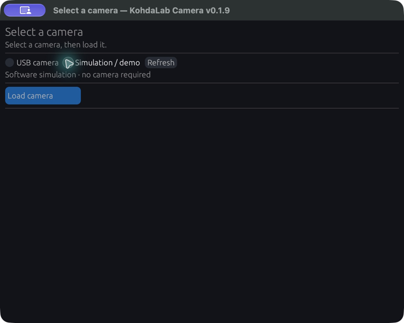
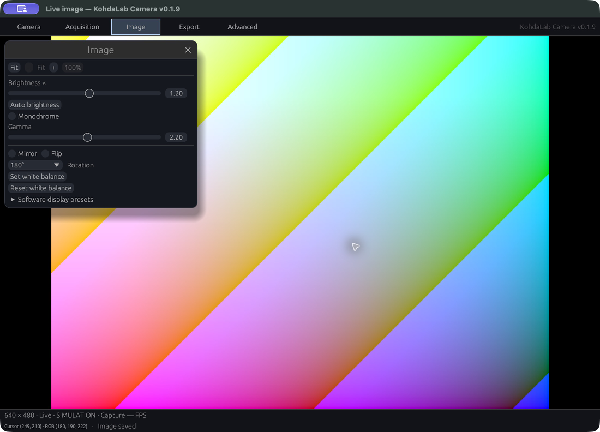

# KohdaLab Camera quick start

KohdaLab Camera is currently distributed for Windows x64. Its supported physical
configuration is the owner-confirmed **SHODENSHA GR300**, using the tested
Micron MT9T001 / USB `0547:4d33` configuration with an existing WinUSB binding.
Other GR300 units, cameras with the same USB ID, and other camera models are not
automatically supported. See [camera support](camera-support.md) for the exact
scope.

## Start a session

The screenshots show the native development preview in Simulation on macOS.
The distributed executable is Windows x64; window decorations differ.

1. Extract the complete Windows portable ZIP. Keep `KohdaLab Camera.exe`,
   `continuous-helper.exe`, and the included license files in the same folder.
2. Start **KohdaLab Camera**. The title bar shows the installed application
   version.
3. If one supported USB camera is found, it is selected automatically. Select
   **Load camera** to connect. If more than one candidate is listed, choose the
   intended camera first.
4. Select **Simulation / demo** and then **Load camera** to explore the UI
   without connecting hardware.

The application does not install, replace, reset, or otherwise change camera
drivers. The physical configuration requires the existing WinUSB setup.

## Everyday controls

The Live window keeps the image in the centre. Use the toolbar, or **F1–F5**, to
open **Camera**, **Acquisition**, **Image**, **Export**, and **Advanced**.
Clicking the selected toolbar tab closes its panel.

- **Camera**: inspect the selected camera and disconnect when finished.
- **Acquisition**: set exposure and analog gain, then use **Apply** to send
  active acquisition changes to the camera.
- **Image**: adjust display brightness, white balance, gamma, rotation, flips,
  monochrome, and image scale. These controls affect the processed preview and
  processed exports; original Bayer data remains available in the export bundle.
- **Export**: save the displayed processed image, or capture a new full-sensor
  frame and then restore the applied Live settings.
- **Advanced**: review diagnostics and restore default settings.

The initial defaults are exposure **120 sensor rows**, brightness **1.20×**,
gamma **2.2**, and analog gain **1×**.

## Navigate the image

Use the mouse wheel over the image to zoom around the pointer, and drag to pan.
Double-click, or use **Fit**, to return to the initial whole-image view.

The scale readout shows **Fit** at the whole-image size and, for example,
**2.0× Fit** when enlarged. **Fit** is the smallest allowed scale: zooming out never makes the image smaller
than its initial whole-image presentation. **100%** means one source pixel per
UI point. It is offered only when that size is reachable between Fit and the
maximum zoom. It is unavailable when Fit already enlarges the image beyond
100%, or when reaching 100% would require more than 32× Fit.

## Save and end normally

Use **Capture image…** to save a processed PNG or TIFF. The dialog proposes
numbered names such as `capture_0001.png`; existing images and their sidecars
are never overwritten.

An export bundle can contain the processed PNG/TIFF, original Bayer TIFF, RAW
data, and metadata. The metadata timestamp is the host UTC time when a complete
frame was accepted; it is not the sensor exposure time.

Choose **Disconnect** when the session is complete, or close the Live window.
Either path requests normal shutdown. Do not remove the helper executable while
the application is running.

Settings, the Live window size, save folder, and capture numbering are
remembered. **Advanced → Reset all settings** returns to the defaults. When a
camera is already active, use **Apply** after resetting settings to update
acquisition controls.
